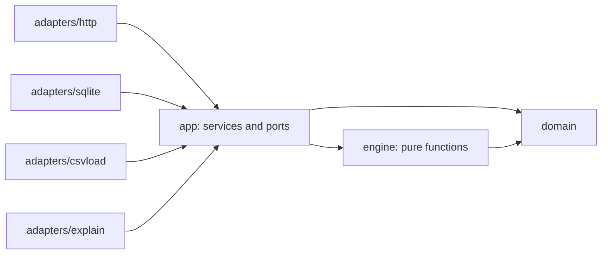

# AI Energy Management Platform

A web console that watches 12 smart meters, runs an anomaly analysis on demand and tells an operator **what is wrong, why, and what to do next**. It is deterministic and offline: rules plus robust statistics, no language model, no API key.

## Quick start

```bash
docker compose up --build
```

Open <http://localhost:8080> and sign in with **`admin` / `admin123`**. No `.env` file and no API key are needed. The first build takes a few minutes.

**Demo flow (5 to 10 minutes)**

1. **Login** with the demo credentials.
2. **Dashboard**: 12 meters, total kWh, status breakdown, no anomalies yet.
3. **Meters**: type `109` in the search box, open **M-109**. Its kWh chart rises from 2026-09-12 14:00.
4. Click **Run AI Analysis**. Seven stages show live progress, then a link to the results.
5. **AI Anomalies**: `4 anomalies detected · 2 require priority attention`, ordered M-109, M-112, M-104, M-106.
6. **Investigation** (click M-109): type, severity, confidence, evidence table, affected window and related event.
7. **Recommended action**: the action card at the bottom of the investigation page.

Reset the data with `docker compose down -v`. Restarting without `-v` keeps the database and past analyses.

## Run without Docker

Two terminals. Requires Go 1.23+ and Node 20+.

```bash
# terminal 1: API on :8080 (seeds SQLite from ../data on first start)
cd backend && go run ./cmd/api

# terminal 2: Vite dev server on :5173, proxies /api to :8080
cd frontend && npm ci && npm run dev
```

## Tests

| Scope | Command |
|-------|---------|
| Backend (one line per package) | `cd backend && go test ./... -count=1` |
| Backend static checks | `cd backend && go vet ./... && gofmt -l .` |
| Frontend unit tests | `cd frontend && npx vitest run --reporter=dot` |
| Frontend type check and build | `cd frontend && npm run build` |
| Engine against the demo data only | `cd backend && go test ./internal/engine -run Dataset -count=1` |

## Architecture

### Backend: hexagonal



| Layer | Rule |
|-------|------|
| `domain` | Entities and enums. No dependencies. |
| `engine` | Pure: imports `domain` and the standard library only. No IO, no clock, no meter ids. |
| `app` | Use cases and ports (repositories, `Explainer`). |
| `adapters` | `http`, `sqlite`, `csvload`, `explain` implement the ports. Only `cmd/api` wires them. |

### Frontend: atomic design plus container/presentational

Vite, React 18, TypeScript (strict), React Router, TanStack Query, Recharts, Tailwind.

| Level | Examples | Notes |
|-------|----------|-------|
| Atoms | `Button`, `Badge`, `Card`, `Skeleton` | No data, props only. |
| Molecules | `StageStepper`, `ConfidenceMeter`, `EvidenceRow` | Small compositions. |
| Organisms | `MetersTable`, `MetricChart`, `AnomaliesTable`, `ActionCard` | Props only. |
| Pages | `MetersPage` (container) and `MetersView` (presentational) | The container fetches; the view renders. |

### Request flow

```
browser -> nginx :8080 -+- /        static SPA (history fallback to index.html)
                        +- /api/    proxy -> api :8080 (not published)
                                              |- ./data (read-only CSV seed)
                                              +- energy-db volume (energy.db)
```

### Async analysis job

`POST /api/ai/analyze` stores a `pending` analysis and returns `202` with its id. A goroutine runs the seven stages and updates `stage` and `progress`; the UI polls `GET /api/ai/analysis/{id}` every 500 ms. Anomalies become visible only when the run is `done`, in one transaction. A second start while a run is active returns the same id. Runs interrupted by a restart are marked `failed` at boot.

### Anomaly engine pipeline

```
Readings -> Baseline -> Detection -> Correlation -> Events -> Explanation -> Recommendation
```

| # | Stage | Work |
|---|-------|------|
| 1 | Readings | Load and group by meter. |
| 2 | Baseline | Per meter and hour of day: median and MAD for kWh, V, A, power factor and the electrical ratio `kWh / (V·A·PF/1000)`. Built from the first `BaselineDays` days. |
| 3 | Detection | Hourly deviation episodes, daily variation, hourly-pattern breaks, data-quality jumps and ratio runs, gaps and non-OK status. |
| 4 | Correlation | Merge signals of one meter and window into **one incident**. Several hits become evidence, not several findings. |
| 5 | Events | Match events, measure recovery, classify. |
| 6 | Explanation | Severity, confidence, evidence items, reason text. |
| 7 | Recommendation | Action, priority rank, dashboard summary. |

**Classification (ordered, first match wins)**

| # | Condition | Type |
|---|-----------|------|
| 1 | Oscillating jumps, unstable electrical ratio, gaps or bad status | `DATA_QUALITY` |
| 2 | Matching event with explanatory power >= 0.7 and compatible direction. Recovered: `FALSE_POSITIVE`. Persistent: `EXPLAINABLE_ANOMALY` | FP or explainable |
| 3 | Everything else, including `UNKNOWN` events | `REAL_ANOMALY` |

Event power: scheduled outage 1.0 (decreases only), operational change 0.9, data-quality event 0 (only raises data-quality confidence), unknown 0. Recovery is measured from the readings (at least `RecoveryMinHours` back inside the gate), never parsed from text.

**Scoring**

| Score | Formula |
|-------|---------|
| Severity (consumption) | `40·min(abs(dailyVar),1) + 20·min(hours/24,1) + corroboration (20 if >=2 signals, 10 if 1) + 20 if REAL`. Explainable is capped at 69 (MEDIUM), false positive at 39 (LOW). |
| Severity (data quality) | `50·min(jumps/10,1) + 30·min(dqHours/24,1) + 20·min(kinds/3,1)` |
| Bands | HIGH >= 70, MEDIUM >= 40, LOW below |
| Confidence (consumption) | `0.5 + 0.2·clamp((abs(effect)-0.30)/0.30,0,1) + 0.15·min(hours/24,1) + 0.1·corroboration/3 + 0.05·clarity`, capped at 0.98 |
| Confidence (data quality) | `0.5 + 0.25·min(jumps/10,1) + 0.15·min(kinds/3,1) + 0.10 if a data-quality event`, capped at 0.98 |
| Priority | `100 · severityWeight(H3/M2/L1) · confidence · typeWeight(REAL 1.0, DQ 0.9, EXPLAINABLE 0.6, FP 0.2) / 3` |

Corroboration counts how many of these moved with consumption: current >= 30%, power factor >= 0.10, electrical ratio >= 20%.

## Thresholds and how they were derived

Every tunable value is a field of `engine.Config` (`backend/internal/engine/config.go`); `DefaultConfig()` returns the values below. They were chosen from the healthy envelope of the eight quiet meters and were **not** changed while calibrating: the dataset test passes with these defaults. Every threshold is generic: changing one is a config change, never a per-meter rule. `TestEngineHasNoMeterLiterals` fails if engine code names a meter or a dataset date, so the per-meter notes below live here and in the tests only.

- **Healthy meters** (M-101, M-102, M-103, M-105, M-107, M-108, M-110, M-111) stay under every threshold, with margin.
- **The four incidents** (M-104, M-106, M-109, M-112) exceed the thresholds that concern them by a wide margin.

### Baseline

| Field | Default | Healthy-envelope evidence | Per-meter justification |
|-------|---------|---------------------------|-------------------------|
| `BaselineDays` | 7 | The window starts at each meter's first reading. The median resists contamination. | Every incident starts on day 8 or later (M-106 on day 8, M-104 on day 11, M-112 on day 13, M-109 on day 12), so the first week is clean. |
| `BaselineMinSamples` | 5 | 7 days give 7 samples per hour of day. | Fewer than 5 samples in an hour means the meter is skipped as `insufficient_history`, never flagged. |
| `MADScale` | 1.4826 | Standard factor that makes MAD consistent with a standard deviation. | Applies to all meters. |
| `MADFloorPct` | 0.03 | A near-zero MAD made the robust z-score exceed 3.5 between 6 and 33 times per healthy meter. | Keeps healthy meters silent; a 3% floor is still far below the 47% to 109% effects. |

### Consumption detection

Hourly and daily thresholds are independent. Raising `HourlyDevPct` only changes what the hourly detector flags; daily variation keeps its own `DailyVarPct` and can still report a day (for example a +47% day) that the hourly gate no longer flags. Each threshold is overridable on its own.

| Field | Default | Healthy-envelope evidence | Per-meter justification |
|-------|---------|---------------------------|-------------------------|
| `HourlyDevPct` | 0.30 | Largest healthy hourly deviation is 17% (margin about 1.8x). | M-104 +47%, M-109 +109%, M-106 about -80%: all clear the gate. |
| `RobustZ` | 3.5 | Standard outlier cut; works with the effect gate, both must hold. | Not the deciding gate for any incident; it blocks noise on flat profiles. |
| `MergeGapHours` | 2 | Tolerates at most 2 unflagged hours inside a same-sign run. | Keeps M-109's 58 h episode as one run. |
| `PersistMinHours` | 6 | Longest healthy streak of flagged hours is 0. | M-106 12 h, M-109 58 h, M-104 96 h or more: all persistent. |
| `SpikeMinHours` | 2 | An episode under 6 h needs at least 2 flagged hours... | No spike occurs in the dataset; guards against isolated noise. |
| `SpikePointPct` | 0.60 | ...or one point of at least 60% (no healthy hour reaches 40%). | No spike occurs in the dataset. |
| `DailyVarPct` | 0.25 | Healthy daily energy varies by 2% at most. | M-104 +47%, M-109 +109% to +110%, M-106 on its outage day. |
| `PatternCorrMax` | 0.80 | Lowest healthy correlation with the baseline profile is 0.934. | Breaks: M-106 day 8 at 0.54, M-109 day 12 at 0.53. M-104's step keeps 0.97, so it is not a break. |
| `PatternShapeMin` | 0.15 | Largest healthy shape deviation is 5.6%. | Breaks: 63.7% (M-106) and 36.8% (M-109). M-104 is 3.4%. |
| `RecoveryMinHours` | 12 | Twice `PersistMinHours`. | M-106 returns to the gate for at least 12 h after its outage (recovered); M-104 and M-109 run to the end of the data (not recovered). |

### Data quality detection

| Field | Default | Healthy-envelope evidence | Per-meter justification |
|-------|---------|---------------------------|-------------------------|
| `VoltJumpV` | 8.0 | No healthy hour-to-hour voltage step above 8 V. | M-112 steps of about 38 V; M-109 only 2 to 3 V. |
| `CurrentJumpPct` | 0.50 | Steps measured against the larger reading (a 2x change at least); no healthy step. | M-112 oscillates; M-106's outage wobble (39 to 61 A) stays below 50%. |
| `PFJump` | 0.15 | Healthy power factor spans 0.87 to 0.99 (width 0.12), so a healthy jump is impossible. | M-112 quantized at 0.58, 0.72 and 0.98. |
| `DQMinJumps` | 3 | Jumps of one metric inside `DQWindowHours`. | M-112 has at least 10. |
| `DQMinReversals` | 2 | Sign reversals among those jumps. | M-109 (1 step) and M-106 (down then up, 1 reversal) are excluded. |
| `DQWindowHours` | 24 | Look-back window for oscillation and for merging cluster windows. | M-112's cluster spans about 45 to 48 h. |
| `RatioDevPct` | 0.20 | Healthy electrical ratio MAD is 3% to 5%. | M-109 stable at +23% to +34%; M-112 unstable from -46% to +294%. |
| `RatioUnstableMinHours` | 3 | At least 3 deviant hours of both signs inside 24 h mean instability. | M-112 (ratio 0.58 to 4.22). |
| `RatioStandaloneMinHours` | 6 | A stable ratio run shorter than 6 h cannot seed an incident: the healthy meters M-107 and M-110 have 1 to 2 hour runs. | M-109's 58 h drift is covered by its consumption episode, so it stays corroboration. Lowering this to 1 makes M-107 and M-110 report false data-quality incidents (checked). |

### Correlation and events

| Field | Default | Healthy-envelope evidence | Per-meter justification |
|-------|---------|---------------------------|-------------------------|
| `EventMatchHours` | 2 | Tolerance between an event and the incident onset. | All three consumption events match their onset exactly (0 h). |
| `AttachSlackHours` | 2 | Secondary signals attach within 2 h of the window and seeds within 2 h merge. | Single current and power factor jumps of M-109 attach to its episode. |
| `ExplainPowerMin` | 0.7 | An explaining event needs power of at least 0.7 (outage 1.0 on a decrease, operational change 0.9 on a persistent shift). | M-106 (outage, 1.0) and M-104 (operational change, 0.9) are explained; M-109's `UNKNOWN` event has power 0. |
| `CorrCurrentPct` | 0.30 | Electrical corroboration of a consumption change: current. | M-109 +110%, M-104 +48%, M-106 about -75%. |
| `CorrPFAbs` | 0.10 | Corroboration: power factor moves by at least 0.10. | M-109 -0.20. |
| `CorrRatioPct` | 0.20 | Corroboration: ratio moves by at least 20%. | M-109 +29%. |

### Severity and confidence

| Field | Default | Healthy-envelope evidence | Per-meter justification |
|-------|---------|---------------------------|-------------------------|
| `SevHigh` | 70 | Severity band boundary (HIGH from 70). | M-109 and M-112 score 100. |
| `SevMedium` | 40 | Severity band boundary (MEDIUM from 40, LOW below). | M-104 scores 49.0 (MEDIUM, and an explained anomaly can never exceed 69); M-106 scores 34.7 (LOW; the forced-LOW cap of 39 is not even needed). |
| `ConfCap` | 0.98 | Never claim certainty. | M-112 computes 1.0 and is reported at 0.98. |
| `ConfHigh` | 0.85 | Confidence label High from 0.85. | M-109 0.975 and M-112 0.98 are High; M-104 0.843 is Medium. |
| `ConfMedium` | 0.60 | Confidence label Medium from 0.60, Low below. | No incident falls below it. |

## Data findings

Dataset: 12 meters x 336 hourly readings (2026-09-01 to 2026-09-14), 4 events. No gaps, no missing values, status `OK` everywhere, so gap and status detection exist but stay silent.

**Healthy envelope (8 meters without events)**: hourly deviation from the hour-of-day median at most 17%, daily energy within about 2%, voltage 216 to 225 V with no hour-to-hour step above 8 V, power factor 0.87 to 0.99. The electrical ratio is not 1.0 in absolute terms (median 1.02 to 1.12), so it is baselined per meter. A point-wise robust z-score above 3.5 fires 6 to 33 times on healthy meters because the MAD is tiny, so the detector also requires a minimum effect size and persistence.

| Meter | What the data shows | Event | Reading |
|-------|---------------------|-------|---------|
| M-109 | From 09-12 14:00 for 58 h, kWh roughly doubles, current about 195 to 410 A, power factor 0.94 to 0.74, ratio 1.07 to 1.3+ | `UNKNOWN`: explains nothing | Real anomaly |
| M-106 | 09-08 00:00 to 11:00, kWh about -80%, back to normal at 12:00 | `SCHEDULED_OUTAGE` at the same hour | Explained and recovered: false positive |
| M-104 | From 09-11 00:00 daily kWh +47%, current 213 to 316 A, stable ratio, never returns | `OPERATIONAL_CHANGE` at the step | Explainable shift |
| M-112 | Daily kWh stable, but every 3 h voltage toggles 202/240 V, power factor quantized to 0.58/0.72/0.98, ratio 0.58 to 4.22 | `DATA_QUALITY` | Metering fault |

## Validation results

Run with `cd backend && go test ./internal/engine -run Dataset -count=1`.

| Rank | Meter | Type | Severity | Confidence | Priority |
|------|-------|------|----------|------------|----------|
| 1 | M-109 | `REAL_ANOMALY` | HIGH (100) | 0.975 | 97.5 |
| 2 | M-112 | `DATA_QUALITY` | HIGH (100) | 0.98 | 88.2 |
| 3 | M-104 | `EXPLAINABLE_ANOMALY` | MEDIUM (49.0) | 0.843 | 33.7 |
| 4 | M-106 | `FALSE_POSITIVE` | LOW (34.7) | 0.858 | 5.7 |

Summary: `4 anomalies detected · 2 require priority attention`.

| Check | Test |
|-------|------|
| The 4 incidents in rank order | `TestDatasetYieldsTheFourExpectedAnomaliesInRankOrder` |
| Events related to the right incidents | `TestDatasetEventsAreRelatedCorrectly` |
| Scores match the walk-through | `TestDatasetScoresMatchTheDesignWalkThrough` |
| 8 healthy meters stay silent | `TestDatasetHealthyMetersProduceNoAnomalies` |
| Still data quality without its event | `TestDatasetMeterWithoutItsDataQualityEventIsStillDataQuality` |
| Shifting every timestamp by 30 days changes nothing | `TestDatasetShiftedByThirtyDaysGivesTheSameFindings` |
| Renaming every meter changes nothing | `TestDatasetWithEveryMeterRenamedGivesTheSameFindings` |
| Summary counts | `TestDatasetSummaryCounts` |
| Identical runs give identical output | `TestDatasetRunsAreIdentical` |
| No meter id or date in engine code | `TestEngineHasNoMeterLiterals` |

## Key decisions and tradeoffs

| Decision | Choice | Tradeoff |
|----------|--------|----------|
| Storage | SQLite (pure Go driver, WAL, one connection) | Zero setup and one file to reset. Single writer, so one API instance. Postgres would be the step for multiple instances. |
| Explanations | Templates behind an `Explainer` port, no LLM | Deterministic, offline, free and testable. Text is less fluent. An LLM adapter can implement the same port later. |
| Detection | Rules plus robust statistics (median, MAD, correlation) | Explainable and reproducible, as the brief allows. Needs calibrated thresholds; see the table above. |
| Incident model | One incident per meter and window, extra signals become evidence | Four clear findings instead of a noisy list. |
| Router | Go stdlib `ServeMux` with method patterns | No dependency. Fewer conveniences than chi or gin. |
| Auth | Stateless HMAC token, demo user from the environment | No session store. Not a user-management system. |
| Stage delay | `ANALYSIS_STAGE_DELAY_MS=300` in compose, 0 in tests | Progress is visible in the demo. Tests stay instant. |
| Frontend | Atomic design with container/presentational pages | More files, but views are testable without a network. |

## Configuration

API environment variables (defaults apply when unset; compose sets the Docker values).

| Variable | Default (local) | In compose | Purpose |
|----------|-----------------|------------|---------|
| `PORT` | `8080` | `8080` | API listen port |
| `DB_PATH` | `./energy.db` | `/var/lib/energy/energy.db` | SQLite file (named volume in compose) |
| `DATA_DIR` | `../data` | `/data` (read-only mount) | Folder with `readings.csv` and `events.csv` |
| `SEED_ON_START` | `true` | `true` | Import the CSVs when the database is empty |
| `DEMO_USER` | `admin` | `admin` | Login user |
| `DEMO_PASSWORD` | `admin123` | `admin123` | Login password |
| `AUTH_SECRET` | `change-me-demo` | `change-me-demo` | Token signing secret. Change it outside a local demo. |
| `TOKEN_TTL` | `12h` | `12h` | Token lifetime |
| `ANALYSIS_STAGE_DELAY_MS` | `0` | `300` | Pause per analysis stage |

Compose also reads `WEB_PORT` (default `8080`) for the host port. See `.env.example`; copy it to `.env` to override.

## API reference

All routes except the first two need `Authorization: Bearer <token>`. Errors look like `{"error":{"code":"not_found","message":"..."}}`.

| Method and route | Purpose |
|------------------|---------|
| `GET /api/health` | Liveness (public) |
| `POST /api/auth/login` | Returns `{token, expires_at, user}` (public) |
| `GET /api/dashboard/summary` | KPIs, status breakdown, last analysis |
| `GET /api/meters?search=&status=&sort=&order=` | Meter list with filters |
| `GET /api/meters/{id}` | Meter detail |
| `GET /api/meters/{id}/readings?from=&to=` | Readings with baseline overlay |
| `GET /api/meters/{id}/events` | Events of a meter |
| `POST /api/ai/analyze` | Start a run: `202 {id, status}` |
| `GET /api/ai/analysis/latest` | Latest run, `204` if none |
| `GET /api/ai/analysis/{id}` | Run status, stage and progress |
| `GET /api/anomalies?analysis_id=&meter_id=&type=&severity=` | Findings of a run (default: latest done) |
| `GET /api/anomalies/{id}` | One finding with evidence and related event |

## Limitations and next steps

| Limitation | Next step |
|------------|-----------|
| Thresholds are calibrated on one two-week dataset. | Re-check them on a longer history and on more meters. |
| The baseline uses the first 7 days of each meter. | Rolling baseline with explicit rebaselining after an accepted change. |
| Single API instance (in-memory single-flight, one SQLite writer). | Postgres and a job queue. |
| One demo user and a stateless token without revocation. | Real user management and refresh tokens. |
| Template text only. | Optional LLM `Explainer` adapter behind the same port. |
| No live ingestion. | Stream readings and run the analysis on a schedule. |
